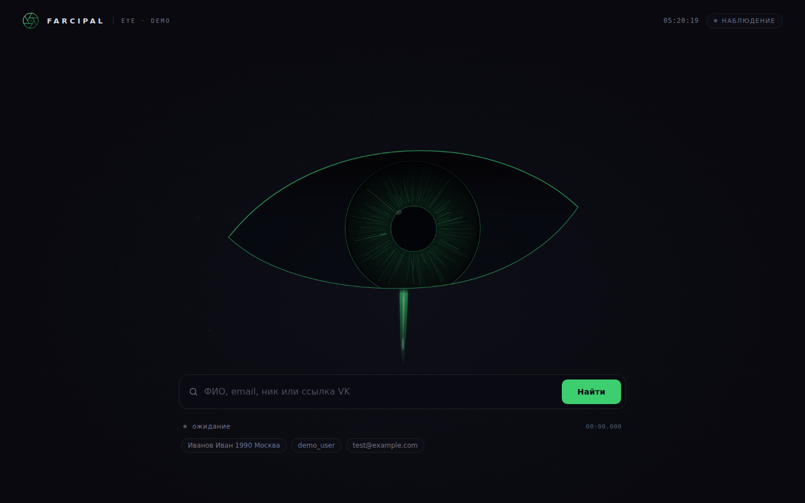
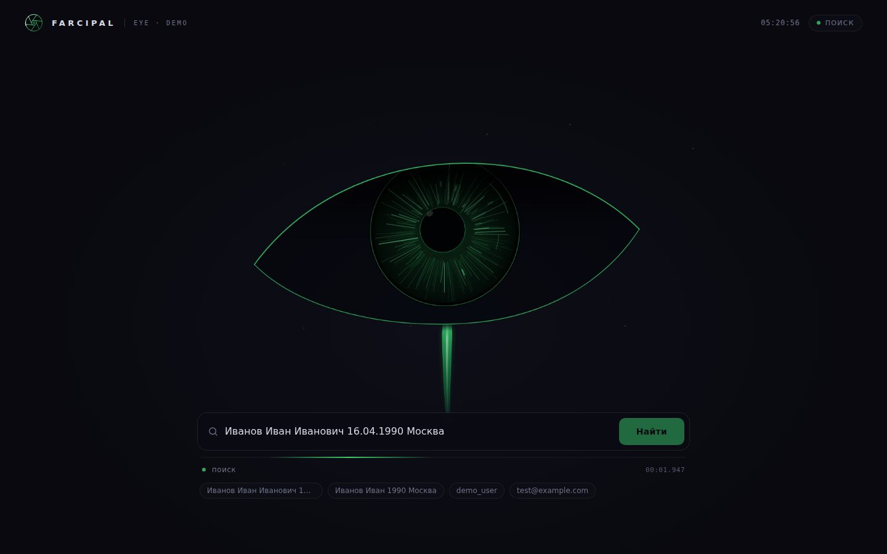
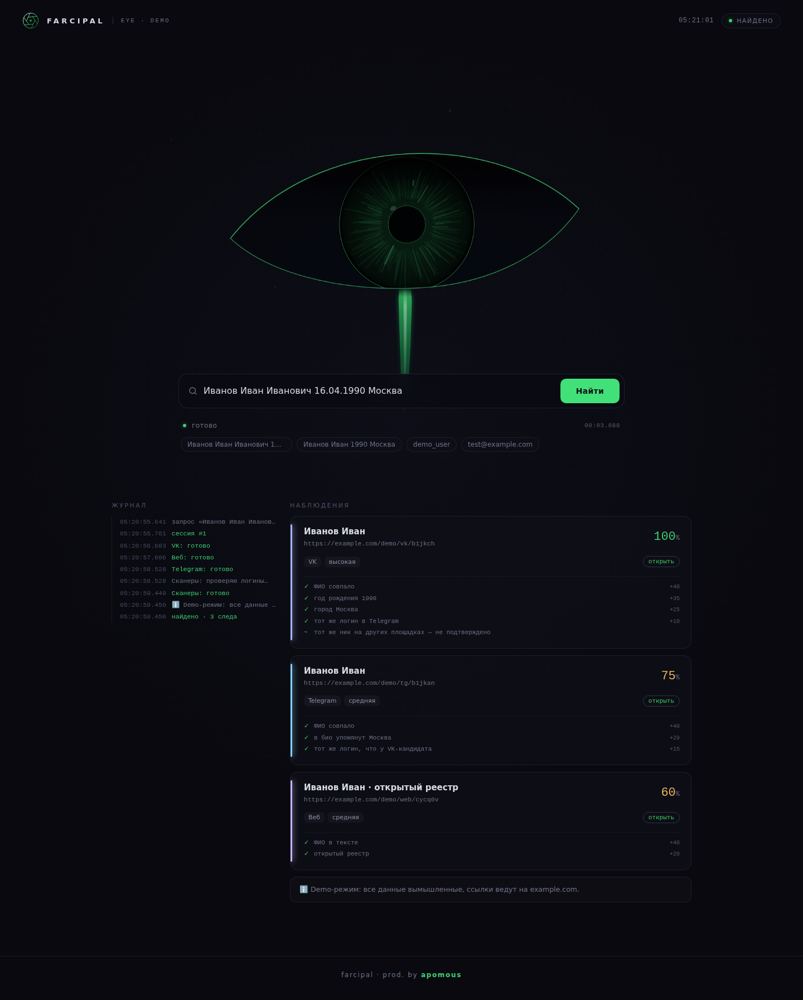
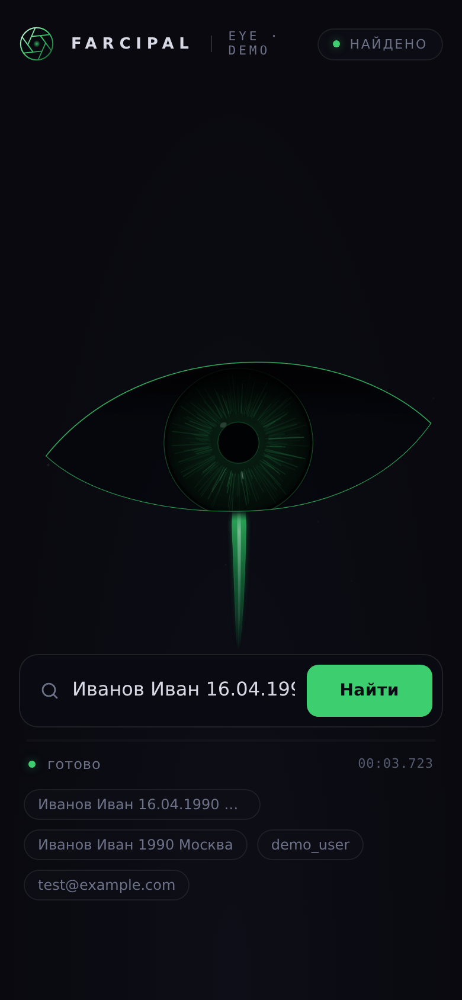

<div align="center">



<br />

# 👁 FARCIPAL · EYE

**Тихий глаз в темноте, который смотрит, ищет и находит.**
Интерфейс для OSINT-поиска на чистых HTML, CSS и JavaScript. Без фреймворков, без сборки, без зависимостей.

<br />

[](https://apomous.github.io/farcipal-eye/)
[](https://github.com/apomous/farcipal-backend)


[Превью](#-превью) · [Состояния глаза](#-состояния-глаза) · [Быстрый старт](#-быстрый-старт) · [Подключение к бэкенду](#-подключение-к-бэкенду) · [Настройка](#-настройка) · [Структура](#-структура)

</div>

---

## ✨ Что это

**FARCIPAL EYE** — фронтенд-часть проекта Farcipal. Страница с живым глазом, который реагирует на всё, что происходит с поиском:

- 🧿 **Глаз нарисован целиком в SVG** и анимируется на `requestAnimationFrame`: радужка из 210 волокон, моргание, саккады, дыхание зрачка, пыль в воздухе, подтёк под глазом.
- 🔎 **Поиск идёт в реальном времени**: результаты появляются по мере готовности источников, а журнал показывает, что делает бэкенд.
- 📊 **Рейтинг совпадения объясняется**: у каждой карточки видно, из чего набран процент (`+40 ФИО совпало`, `+35 год рождения`).
- 🛡 **Безопасный вывод**: всё, что пришло из внешних источников, выводится только через `textContent`, ссылки проверяются.
- 🎬 **Demo-режим**: интерфейс работает без бэкенда, на вымышленных данных. Удобно для GitHub Pages и для проверки дизайна.
- 📱 **Адаптивная вёрстка** и поддержка `prefers-reduced-motion`.

> [!NOTE]
> Этот репозиторий содержит только интерфейс. Поисковая часть лежит отдельно: **[farcipal-backend](https://github.com/apomous/farcipal-backend)**.

## 🎬 Превью

<table>
  <tr>
    <td width="50%"><br /><sub><b>Поиск.</b> Глаз сканирует, подтёк пульсирует, в журнале видно ход работы.</sub></td>
    <td width="50%"><br /><sub><b>Результаты.</b> Карточки с процентом и разбором рейтинга по баллам.</sub></td>
  </tr>
</table>

<div align="center">
  <br />
  <sub>Мобильная версия</sub>
</div>

## 🧿 Состояния глаза

Глаз работает как маленький конечный автомат. Состояние меняется само, в зависимости от ответа бэкенда.

| Состояние | Когда | Что происходит |
| --- | --- | --- |
| `idle` | ожидание | Следит за курсором с задержкой в полсекунды, дрейфует, моргает. Когда вы печатаете, смотрит вниз на строку поиска |
| `scanning` | идёт поиск | Быстрые саккады, лучи пробегают по радужке, зрачок сужается, подтёк удлиняется и пульсирует |
| `found` | есть результаты | Яркая вспышка, пять расходящихся колец, подтёк расширяется |
| `empty` | ничего не найдено | Веко опускается, взгляд уходит в сторону, цвета гаснут |
| `error` | сбой | Дрожь, красный подтёк, прикрытое веко |

## 🚀 Быстрый старт

### Вариант 1. Просто открыть

Скачайте репозиторий и откройте `index.html` в браузере. Без бэкенда интерфейс сам включит [demo-режим](#-demo-режим).

### Вариант 2. Локальный сервер

```bash
git clone https://github.com/apomous/farcipal-eye.git
cd farcipal-eye
python -m http.server 8000
```

Откройте <http://localhost:8000/?demo>.

### Вариант 3. Вместе с бэкендом

Положите интерфейс в папку `ui` рядом с бэкендом, и тот отдаст его сам:

```bash
git clone https://github.com/apomous/farcipal-backend.git
cd farcipal-backend
git clone https://github.com/apomous/farcipal-eye.git ui
# дальше по инструкции из README бэкенда
```

## 🔌 Подключение к бэкенду

Интерфейс общается с бэкендом по трём запросам и ожидает, что бэкенд отдаёт страницу с того же адреса (same-origin). Если вы пишете свой бэкенд, достаточно повторить эти ответы.

| Запрос | Ответ |
| --- | --- |
| `POST /search` с телом `{"query": "..."}` | `{"id": 1}` |
| `GET /result/{id}` | состояние поиска (см. ниже) |
| `GET /history?limit=24` | `[{"query": "..."}]` |

<details>
<summary><b>Формат ответа <code>GET /result/{id}</code></b></summary>

```jsonc
{
  "id": 1,
  "status": "running",          // running | done | error
  "duration": 3.4,              // секунд, когда status = done
  "progress": ["VK: готово", "Веб: готово"],
  "partial": { "vk": [ /* карточки */ ] },   // промежуточные результаты, пока идёт поиск
  "result": {                   // когда status = done
    "type": "person",           // person | text | error
    "query": "Иванов Иван",
    "year": 1990,
    "city": "Москва",
    "vk":  [ /* карточки */ ],
    "tg":  [ /* карточки */ ],
    "web": [ /* карточки */ ],
    "vk_name_matches": 4,
    "need_context": false,
    "notes": ["пояснение для пользователя"]
  }
}
```

Для `type: "text"` и `type: "error"` в `result` достаточно поля `text`.

**Карточка**

```jsonc
{
  "source": "vk",
  "url": "https://example.com/profile",
  "title": "Иван Иванов",
  "score": 92,
  "label": "высокая",
  "links": ["https://example.com/other"],
  "evidence": [
    { "mark": "✓", "text": "ФИО совпало", "pts": 40 },
    { "mark": "~", "text": "тот же ник на другой площадке", "pts": 0 }
  ]
}
```

Цвет процента: от 80 зелёный, 55–79 янтарный, ниже красный.

</details>

## 🔧 Настройка

### `config.js`

```js
window.FARCIPAL = {
  demo: location.hostname.endsWith("github.io") ||
        location.protocol === "file:" ||
        new URLSearchParams(location.search).has("demo"),
};
```

### Цвета

Палитра задаётся переменными в начале `style.css`:

```css
:root {
  --bg: #09090f;     /* фон */
  --green: #3dcf6f;  /* основной акцент глаза */
  --ui: #3dcf6f;     /* кнопка */
  --amber: #e8b45a;  /* средний рейтинг */
  --red: #f87171;    /* ошибки */
}
```

Цвета подтёка (`--t1`, `--t2`, `--te`) лежат рядом, в блоке `#eye`. При ошибке они меняются на красные.

### Подтёк и глаз

- Форма и длина подтёка по состояниям: функция `updateTear` в `app.js`, параметр `lenT`.
- Скорость и стиль глаза по состояниям: объект `STATES` в `app.js`.
- Контур века: константы `UPPER` и `LOWER` в начале `app.js`.

## 🧪 Demo-режим

Включается сам на GitHub Pages, при открытии файла с диска и по адресу `?demo`. В нём нет сетевых запросов: ответы бэкенда имитирует `demoApi()` в `app.js`.

Что попробовать в строке поиска:

| Запрос | Что покажет демо |
| --- | --- |
| `Иванов Иван 16.04.1990 Москва` | три карточки (VK, Telegram, веб) с разбором рейтинга |
| `demo_user` | текстовый ответ по нику |
| `me@example.com` | ответ по email |
| `Петров Пётр пусто` | состояние «ничего не найдено» |
| `ошибка` | состояние «сбой» |

> [!IMPORTANT]
> Все данные в демо вымышленные, а ссылки ведут на `example.com`.

## 🗂 Структура

```text
farcipal-eye/
├── index.html      # разметка и SVG-глаз
├── style.css       # стили
├── app.js          # анимация глаза, поиск, отрисовка результатов, demo-режим
├── config.js       # настройки
├── favicon.svg
├── docs/           # скриншоты для README
└── .github/workflows/pages.yml   # публикация на GitHub Pages
```

## ♿ Доступность и производительность

- Подписи `aria-label`, поле поиска с `label`, статус поиска в `aria-live`.
- При включённом `prefers-reduced-motion` отключаются дрейф, пыль и пульсации.
- Анимация идёт одним циклом `requestAnimationFrame`, DOM-узлы переиспользуются, поэтому нагрузка небольшая.

## 🌐 Браузеры

Современные Chrome, Edge, Firefox и Safari. Нужны SVG, `requestAnimationFrame`, CSS-переменные и `backdrop-filter`.

## 🌍 English

<details>
<summary>Short summary</summary>

**FARCIPAL EYE** is a dependency-free frontend (HTML, CSS, vanilla JS) for an OSINT search tool. An SVG eye reacts to the search state (idle, scanning, found, empty, error), results stream in as backend modules finish, and every match shows how its score was calculated. It talks to the backend through three endpoints (`POST /search`, `GET /result/{id}`, `GET /history`) and ships with a demo mode that runs entirely in the browser with fictional data. Open `index.html` or add `?demo` to try it.

</details>

## 📄 Лицензия

[MIT](LICENSE) © 2026 apomous
